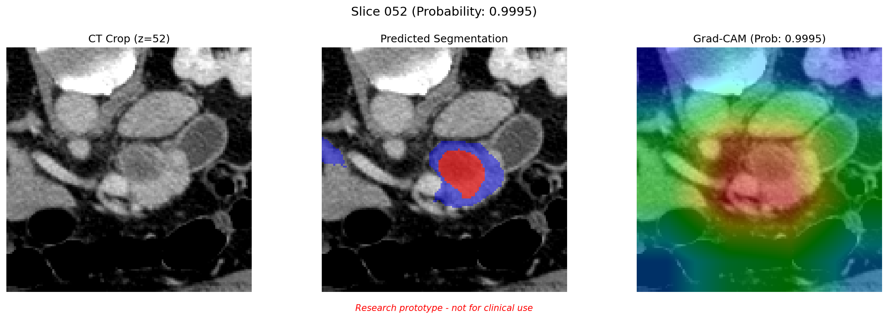

# Pancreas CAD: multi-stage pancreatic tumor segmentation and explanation from CT


> **Research prototype. Not clinically validated. Not for diagnosis or any clinical decision.**

A reproducible, openly documented pipeline that segments the pancreas and tumor in contrast-enhanced CT, scores individual slices for tumor with a classifier, and shows Grad-CAM heat maps. It was built as a final-year project with free tools only (PyTorch, MONAI, a free cloud GPU) on a public dataset.

The honest summary: the pancreas is outlined well, large tumors are usually found, **small tumors are mostly missed**, and the slice classifier is weak. The results below say exactly how well each part works.

<p align="center">
  
</p>
<p align="center"><em>Example output (test case pancreas_198). Blue: predicted pancreas, red: predicted tumor. The Grad-CAM panel shows what influenced the slice classifier; it is coarse and should not be read as tumor localization.</em></p>

## What it does

```
CT volume -> preprocessing -> 3D U-Net segmentation -> slice crops -> ResNet18 slice classifier -> Grad-CAM -> result.json + figures
```

1. **Preprocessing:** resample to 1.0 x 1.0 x 2.5 mm and apply a fixed intensity window of [-100, 240] HU scaled to [0, 1].
2. **Segmentation:** a MONAI 3D U-Net labels background, pancreas and tumor with sliding-window inference.
3. **Slice classification:** a ResNet18 scores each axial slice that contains predicted pancreas for the presence of tumor.
4. **Explainability:** Grad-CAM heat maps (implemented in this repository) for the top-scoring slices.

The pipeline reports the segmentation finding and the classifier finding **separately** and never combines them into a diagnosis.

## Results (held-out test split, 42 cases, evaluated once)

Data: MSD Task07 Pancreas, 281 labelled cases, fixed split of 197 train / 42 validation / 42 test, stratified by tumor size (`docs/splits.json`). Intervals are 95% bootstrap or Wilson intervals.

**Segmentation**

| Group | Cases | Pancreas Dice | Tumor Dice | Tumor found |
|---|---|---|---|---|
| Overall | 42 | 0.762 [0.720, 0.797] | 0.323 [0.232, 0.419] | 28/42 (66.7%) |
| Small tumors (< 20 mm) | 14 | 0.794 [0.762, 0.824] | 0.128 [0.027, 0.252] | 5/14 (35.7%) |
| Large tumors (>= 20 mm) | 28 | 0.746 [0.685, 0.796] | 0.421 [0.309, 0.530] | 23/28 (82.1%) |

"Tumor found" means at least one predicted tumor voxel overlaps the true tumor, a lenient criterion.

**Slice classifier** (1,398 test slices): ROC AUC **0.666** [0.598, 0.732]. At the validation-chosen threshold: sensitivity 0.683, specificity 0.517. The accuracy at threshold 0.5 (0.709) is not meaningful, because 71.4% of the slices are negative and predicting "no tumor" everywhere scores 71.4%.

**Targets in `requirements.md`:** pancreas Dice above 0.6 is **met**. The classifier targets (AUC above 0.75; accuracy, sensitivity, specificity and F1 above 0.70) are **not met**.

**A negative result worth knowing:** shifting the tumor decision threshold (tested on the validation split only) found more tumors only by over-segmenting and was not adopted. See `docs/results/calibration/`.

Full details, training curves and limitations: [`docs/results_segmentation.md`](docs/results_segmentation.md), [`docs/results_classification.md`](docs/results_classification.md), [`docs/results_pipeline.md`](docs/results_pipeline.md).

## Limitations

- One public dataset, one fixed split, no external validation.
- Every MSD case contains a tumor, so false-positive behavior and case-level specificity are **not measured**.
- The collection mixes several types of pancreatic mass, so results are not specific to pancreatic ductal adenocarcinoma.
- Small tumors are mostly missed; the slice classifier overfits and is weak.
- About two GPU-hours of training and no hyperparameter search.

## Quick start

```bash
git clone https://github.com/Abhijeet1708/pancreas-cad-system.git
cd pancreas-cad-system
pip install -r requirements.txt
python -m pytest tests/ -q
```

**Demo app** (examples mode works without any model files):

```bash
streamlit run app/streamlit_app.py
```

Upload mode needs the two model files `models/seg_best.pt` and `models/cls_best.pt`. They are not stored in the repository (see [Model weights](#model-weights)). Without a GPU, analyzing a full volume can take several minutes.

**Run the pipeline on one scan:**

```bash
python -m src.pipeline.run --input case.nii.gz \
  --seg-checkpoint models/seg_best.pt --cls-checkpoint models/cls_best.pt --out-dir out/
```

Accepted inputs are `.nii`, `.nii.gz`, or a preprocessed `.npz`. The output folder contains `result.json`, `prediction.npz` and slice figures.

## Reproducing the experiments

The training runs used Kaggle notebooks (one Tesla T4). The commands below are what those notebooks ran.

```bash
# 1. data (MSD Task07 Pancreas, https://medicaldecathlon.com) -> data/raw/images and data/raw/labels
python src/preprocessing/download_data.py      # uses a public mirror that may disappear; the official site is the reliable source
python -m src.preprocessing.preprocess --data-root data/raw --output-dir data/processed

# 2. the split is committed (docs/splits.json); do not regenerate it
#    python -m src.segmentation.splits --stats docs/dataset_stats.csv --out docs/splits.json

# 3. segmentation
python -m src.segmentation.train --data-root data/processed --splits docs/splits.json --out-dir runs/seg \
  --max-iterations 30000 --val-every 2500 --val-cases 0 --max-minutes 75
python -m src.segmentation.evaluate --data-root data/processed --splits docs/splits.json --stats docs/dataset_stats.csv \
  --checkpoint runs/seg/best.pt --out-dir results/seg_val --split val        # test needs --final

# 4. slice classifier
python -m src.classification.slices --data-root data/processed --splits docs/splits.json --out-dir cls_data
python -m src.classification.train --data-dir cls_data --out-dir runs/cls --epochs 15 --batch-size 64 --pretrained
python -m src.classification.evaluate --data-dir cls_data --checkpoint runs/cls/best.pt --out-dir results/cls_val --split val
```

Training can resume across sessions with `--resume-from runs/seg/last.pt` (keep `--max-iterations` unchanged). The evaluation scripts refuse to read the test split unless `--final` is given, so the test set is used on purpose and only once.

## Model weights

The weights are not committed (`models/` is git-ignored). *TODO: add a link to the GitHub Release that holds `seg_best.pt` (segmentation, iteration 22,500) and `cls_best.pt` (classifier, epoch 11).* Check the dataset license before redistributing weights or images.

## Project structure

```
src/preprocessing/   data download, verification, resampling and windowing
src/segmentation/    split, patch sampling, 3D U-Net, training, evaluation, threshold calibration
src/classification/  slice dataset builder, ResNet18, training, evaluation
src/explainability/  Grad-CAM
src/pipeline/        end-to-end pipeline, loaders, display helpers
app/                 Streamlit demo
tests/               84 automated tests (CPU, synthetic data only)
docs/                requirements, split, dataset statistics, results and figures
```

## Engineering practice

The project was developed in ten phases, each tracked as an issue, built on its own branch, and merged by pull request after continuous integration (flake8 and pytest on every push) passed. The test split is protected in code, checkpoints are written atomically, and training can resume after a session limit. AI coding assistants were used to write code under this process; every change was reviewed and checked by the automated tests.

## Roadmap

- nnU-Net baseline and 5-fold cross-validation.
- Two-stage segmentation (pancreas first, then tumor at higher resolution) and tumor-focused training for small tumors.
- A 2.5D or 3D classifier.
- Tumor-free scans (for example NIH Pancreas-CT) to measure specificity and false positives.
- External validation.

## Data credit and citation

Data: Medical Segmentation Decathlon, Task07 Pancreas (Antonelli et al., Nature Communications, 2022). Check the dataset license before redistributing any data or figures derived from it. Methods used: U-Net (Ronneberger et al., 2015), MONAI (Cardoso et al., 2022), ResNet (He et al., 2016), Grad-CAM (Selvaraju et al., 2017). The full reference list is in the project report.

## License

Code: MIT License (see `LICENSE`). The dataset has its own license.

## Authors

*Add names and the guide's name here.* Department of Computer Science and Engineering, Nagesh Karajagi Orchid College of Engineering and Technology, Solapur (DBATU, Lonere), 2026-27.
